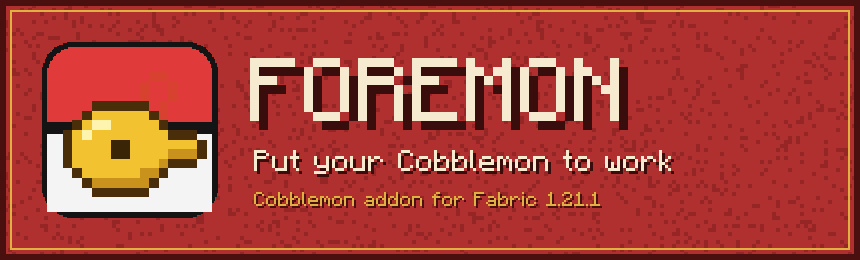

Foremon is a Cobblemon addon that puts your Pokemon to work. Right-click any chest with the Work Whistle and it
becomes a job site: pick a job, pick Pokemon from your party or your PC, and they chop trees, dig out mines, farm,
smelt, sort, haul, craft, guard your village and build your Litematica schematics block by block. There are no loot
tables and no magic: workers walk to the tree, the ore or the scaffold, play their own attack animations and carry
everything back to the chest.

Every species is rated for every job from its stats, types, ability, moves, size and nature, so the crew you pick
matters. A Machop chops, a Geodude digs, a Charmander smelts, a Pidgey hauls. Hover over any Pokemon to see why.

**Note:** get the latest version, it has all the fixes.

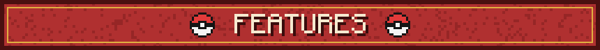

- **Ten jobs**, each doing real work in the world (see Jobs below).
- **Types decide the crew.** Fire Pokemon smelt without fuel, Fighting types chop faster, Flying types haul.
- **Pokemon grow.** Level perks unlock as they level up: at level 50 a lumberjack fells a whole tree in one swing.
  Each Pokemon also ranks up from Novice to Master in its jobs.
- **Build from Litematica.** Place a schematic, press Load plan, fill the chest. The crew builds it from the bottom up.
- **Requests.** Sites ask for what they are short of (a builder out of a block, guards out of torches) and your
  haulers bring it from your other chests.
- **Hauling routes** from any chest to any chest, up to 5000 blocks away with the Supply Lines skill.
- **Guard map.** Draw guard areas, keep-out boxes, no-torch boxes and a patrol route on a map of the area, and post
  guards to the areas you want them in.
- **A 49-upgrade skill tree** in four branches. Start with one chunk and one worker, end with crews across many sites.
- **A journal for everything:** crew, jobs, PC box, chests, routes, map, filter, skill tree, level perks, the Work Dex
  (the best Pokemon you own for each job) and a guide.
- **Your base, your way.** Mark chests with a Poke Ball, from Poke Ball to Master Ball, each with its own filter.

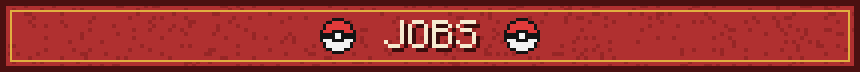

- **Lumber:** chops natural trees in the work area and replants saplings.
- **Mining:** digs out the area you mark, top to bottom. What a Pokemon can break depends on its level and type.
- **Farming:** harvests and replants ripe crops, berries and apricorns.
- **Smelting:** Fire Pokemon smelt whatever is in the chest. No fuel needed.
- **Sorting:** moves items into linked chests that already hold that item.
- **Hauling:** moves items along routes between any two chests, and fills other sites' requests.
- **Building:** builds your Litematica placement from the blocks in the chest.
- **Demolition:** takes the marked area apart and brings the blocks back.
- **Guard:** fights off hostile mobs, the ones going for villagers first, and puts torches wherever mobs could spawn.
- **Crafting:** makes the items you list in the filter until there is a stack of each, and asks for what it is short of.

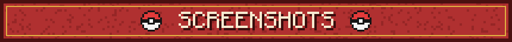

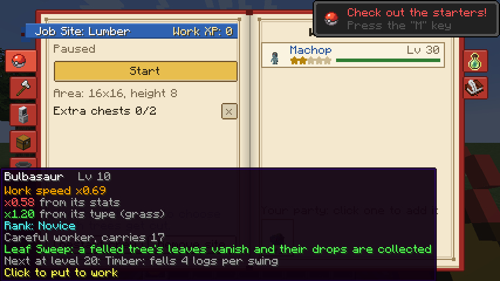

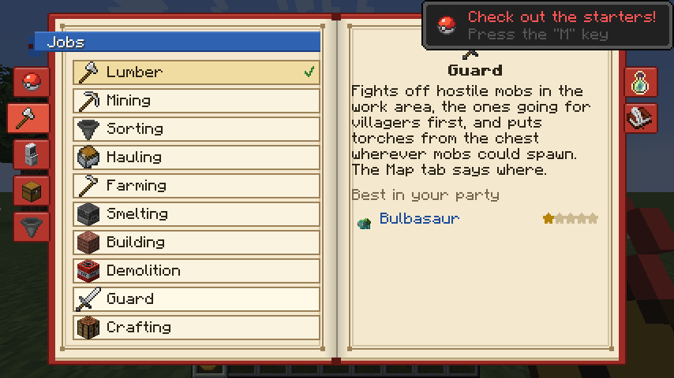

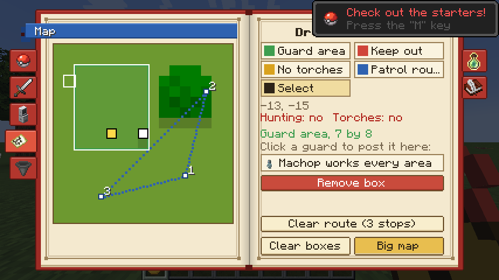

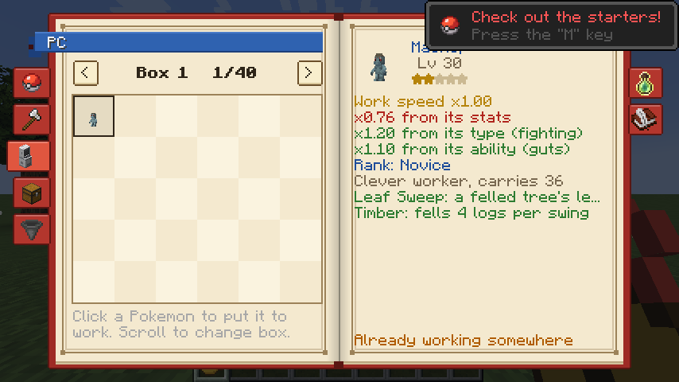

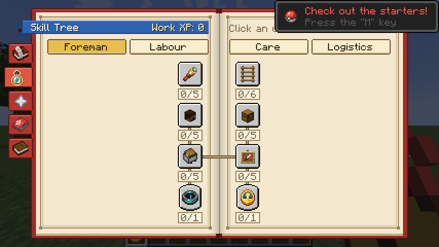

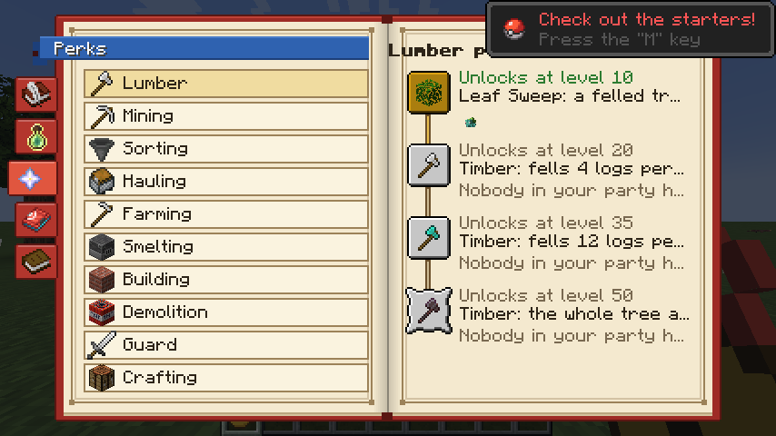

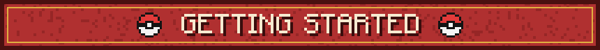

1. Craft a **Work Whistle** (two gold ingots and a string).
2. Right-click a chest with it.
3. Pick a job, click a Pokemon, press **Start**.

Right-click the air with the whistle for your job sites, the skill tree, the level perks, the Work Dex and the guide.

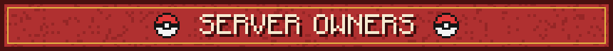

- Safe by default: workers only touch blocks and chests their owner could, and claim mods that use Fabric's
  block-break event are respected.
- One switch for Relaxed, Normal or Hardcore, plus every number in `config/foremon.json`.
- Rules and the skill tree are data, so a data pack can retune everything.
- `/foremon admin perf` shows what the mod costs per tick. In testing, 20 workers on 5 sites cost under 1 ms per tick.

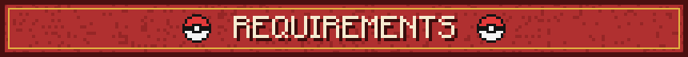

Minecraft 1.21.1 with Fabric Loader, and:

- [Cobblemon](https://www.curseforge.com/minecraft/mc-mods/cobblemon) 1.7.3 or newer
- [Fabric API](https://www.curseforge.com/minecraft/mc-mods/fabric-api)
- [Fabric Language Kotlin](https://www.curseforge.com/minecraft/mc-mods/fabric-language-kotlin)
- Optional: [Litematica](https://www.curseforge.com/minecraft/mc-mods/litematica) (only for building from schematics)

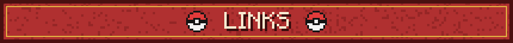

Report issues here (search first): [github.com/arusadusdg/foremon/issues](https://github.com/arusadusdg/foremon/issues)

Source code: [github.com/arusadusdg/foremon](https://github.com/arusadusdg/foremon)

Also on Modrinth: [modrinth.com/mod/foremon](https://modrinth.com/mod/foremon)

TikTok: [@foremoncobblemon](https://www.tiktok.com/@foremoncobblemon)

---

Foremon was designed by its author and written with the help of an AI coding assistant (Anthropic's Claude), which
wrote most of the code, tests and texts under the author's direction. Every feature is checked by automated tests in a
real Minecraft server.
